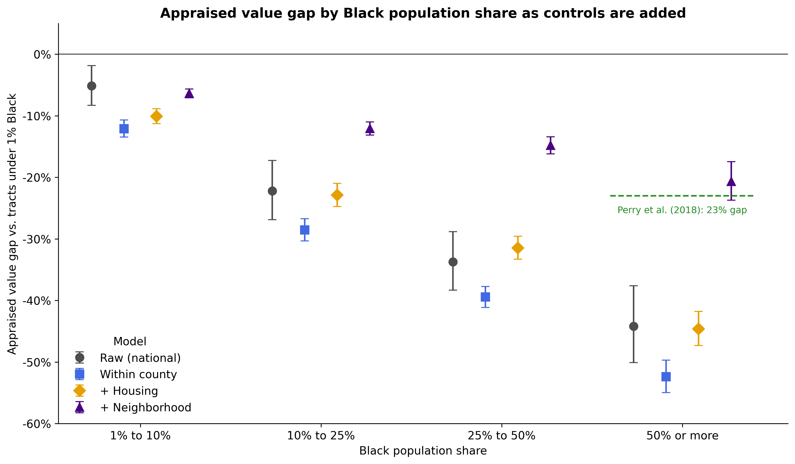

# Priced Out of Equity

**Are homes in majority-Black and historically redlined neighborhoods appraised below comparable homes, and if so, where does the gap come from?**

Home equity is how most American families build wealth and pass it down. When homes in some neighborhoods are consistently valued below similar homes elsewhere, the people who live there have less to borrow against, less to gain from a sale, and less to leave to the next generation. This project measures that gap using the appraisals lenders actually rely on, across more than 83,000 U.S. census tracts.

## What I found

- **Homes in majority-Black neighborhoods are appraised well below comparable homes in the same county.** The gap is roughly 45% after accounting for the age, size, and type of homes, and about 21% after also accounting for neighborhood income, education, and homeownership. That second figure closely matches an earlier Brookings study that used homeowners' own estimates instead of appraisals.
- **Most of the gap is set by the market, not the appraisal itself.** Appraisals in majority-Black neighborhoods do fall below the agreed sale price more often, but once lower price levels are accounted for, the remaining difference is small. It grows in neighborhoods where nearly all residents are Black.
- **The legacy of 1930s redlining still shows up in home values today,** beyond who lives in a neighborhood now. It works through prices rather than through appraisals directly.
- **One appraisal practice carries different consequences by neighborhood.** Relying on nearby sales from the same neighborhood makes no difference in most places, but in majority-Black neighborhoods it goes with more appraisals falling short of the agreed price.
- **Leaving race out of a valuation model does not keep racial patterns out of its predictions.** A model that never saw race still expected majority-Black neighborhoods to be worth 37% less, because features like income and education carry the pattern in.

*Each marker shows how much lower homes are appraised compared with neighborhoods under 1% Black. The gap grows with Black population share in every model, and it remains after accounting for housing and neighborhood differences.*

## How it works

The analysis combines four public data sources at the census tract level: appraisal statistics from the Federal Housing Finance Agency (FHFA) for 2019 to 2023, neighborhood characteristics from the American Community Survey, historic redlining scores, and federal metro area definitions.

It uses two independent methods. Regression compares each neighborhood only with others in the same county, adding controls in stages to show how much of the gap each set of factors explains. A gradient boosting model (LightGBM) predicts what each neighborhood's homes would be worth with race excluded, tested on states it never saw during training, and SHAP values show what drives its predictions. Both methods point to the same conclusion. Six robustness checks, including alternative market definitions, model types, and corrections for missing data, did not overturn any finding.

## Limits

These results describe neighborhoods, not individual appraisals or appraisers. Tract-level data cover loans backed by Fannie Mae and Freddie Mac only, since FHA appraisals are not published at this level, and about half of majority-Black neighborhoods had too few sales to be reported. The data end before the 2025 changes to federal appraisal policy.

## Connection to QRoots

[QRoots](https://qroots.onrender.com) scores U.S. census tracts on quality of life. This project produces a tract-level table (`Data/Processed/qroots_valuation_gap.csv`) showing how each neighborhood's appraised values compare with what similar neighborhoods would be expected to receive. The table was designed with fair housing in mind:

- It contains **no racial or ethnic data**, so it cannot be used to filter or rank neighborhoods by race.
- Each estimate comes with an **uncertainty range** rather than a single precise number.
- Labels are **neutral comparisons with a model**, and a neighborhood is marked "appraised below expected range" only when its entire range falls below zero.

## Repository contents

| Path | Contents |
|---|---|
| `home_valuation_gap_analysis.ipynb` | The full analysis, with an explanation before and an interpretation after every step |
| `Figures/` | The five figures used in the write-up |
| `Data/Processed/qroots_valuation_gap.csv` | Tract-level valuation gap table for QRoots |
| `Data/Raw/README.md` | Links to every raw data source |
| `requirements.txt` | Python package versions |

## Reproducing the analysis

1. Download the raw files listed in `Data/Raw/README.md` into `Data/Raw/`.
2. Install the packages in `requirements.txt` (Python 3.11).
3. Get a free [Census API key](https://api.census.gov/data/key_signup.html) and save it as an environment variable named `CENSUS_API_KEY`.
4. Run the notebook from top to bottom. The first run builds the processed files; later runs use the cached versions.

## Key references

- Freddie Mac. (2021). *Racial and ethnic valuation gaps in home purchase appraisals.*
- Perry, A. M., Rothwell, J., & Harshbarger, D. (2018). *The devaluation of assets in Black neighborhoods: The case of residential property.* Brookings Institution.
- Meier, H. C. S., & Mitchell, B. C. (2023). *Historic redlining indicator for 2000, 2010, and 2020 US census tracts.*

---

Tim Hollis · [LinkedIn](https://www.linkedin.com/in/timothy-hollis) · [Medium](https://medium.com/@TTHollis)